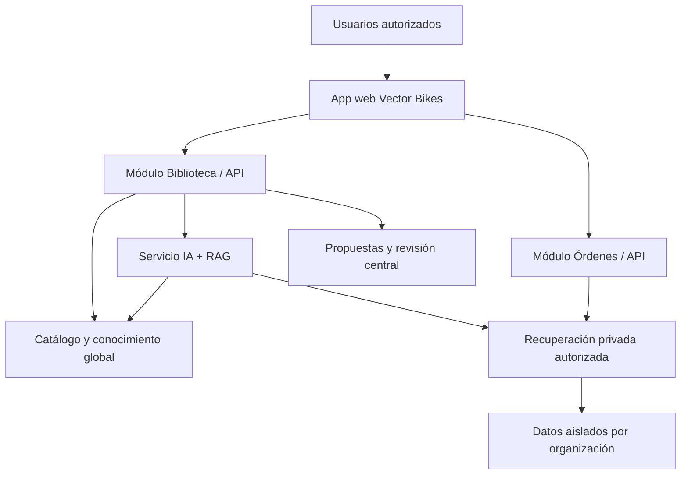
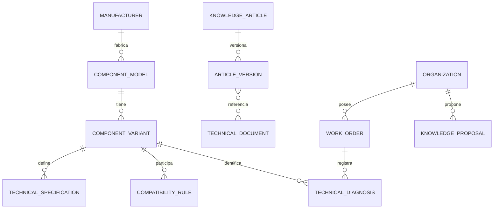
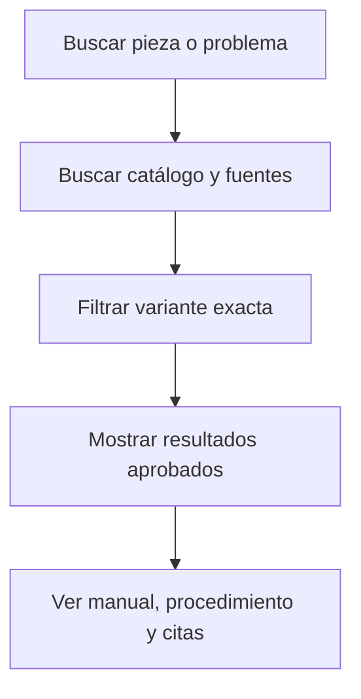
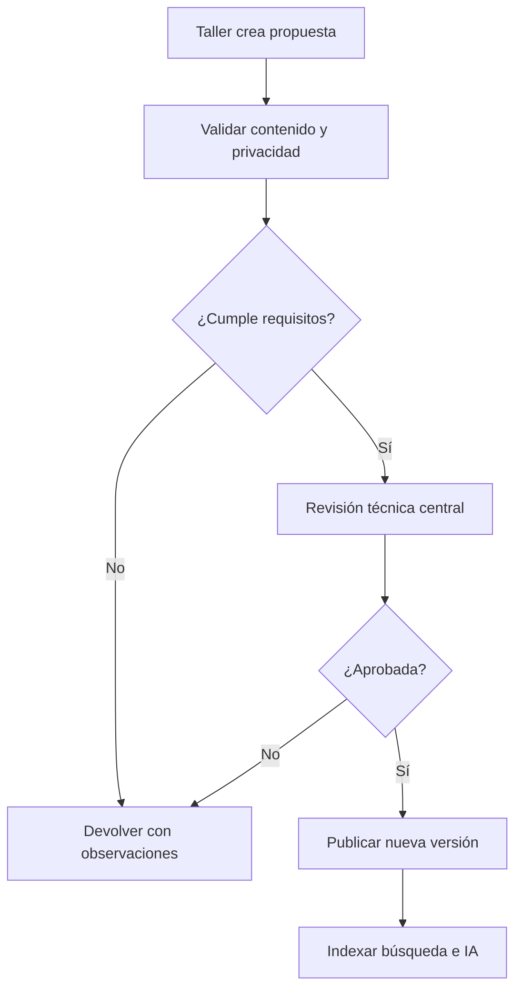
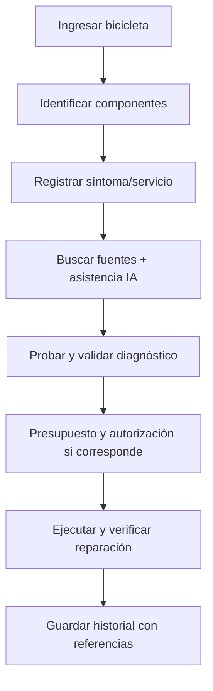
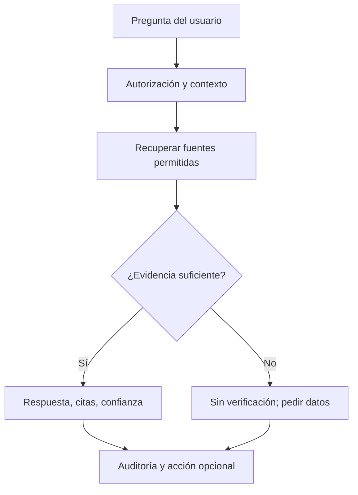
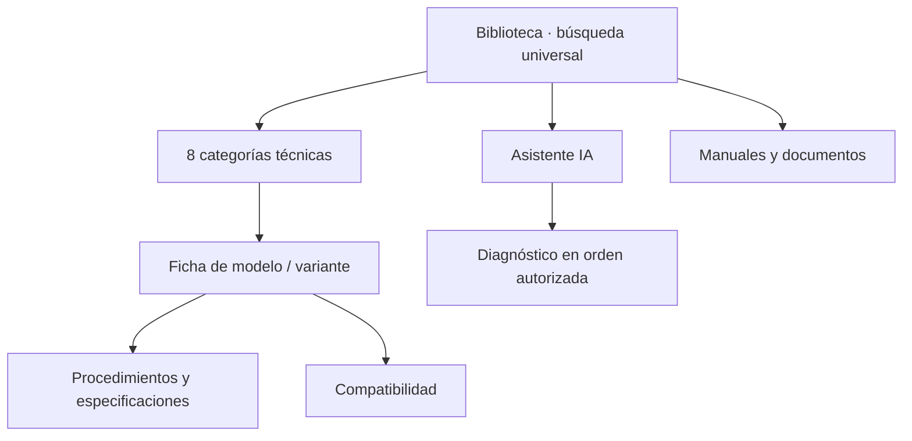

# VECTOR BIKES — Biblioteca Técnica Multiempresa

> **Especificación funcional, técnica, visual y plan de ejecución para Claude en modo automático**  
> Versión: 1.0 · Fecha: 15 de noviembre de 2026 · Estado: diseño aprobado para implementación, sujeto a inspección del repositorio

## 0. Instrucción maestra para Claude (leer primero)

**Rol:** actuar como ingeniero principal full-stack, arquitecto de datos, responsable de seguridad, diseñador de experiencia de usuario y QA para implementar la Biblioteca Técnica Multiempresa dentro del software de talleres Vector Bikes.

**Modo de ejecución solicitado: AUTOMÁTICO / AUTÓNOMO.** Una vez autorizado el acceso al repositorio y al entorno, trabajar de forma continua en ciclos de inspección → planificación → implementación → pruebas → corrección → documentación, **sin detenerse voluntariamente tras cada fase ni solicitar confirmación por decisiones técnicas menores**. Continuar hasta cumplir todos los criterios de aceptación verificables de este documento. No afirmar que está completo si quedan pruebas fallidas o funcionalidades simuladas.

**Límites operativos:** respetar permisos existentes y las políticas del entorno. Solicitar intervención solo ante decisiones de negocio no especificadas que cambien materialmente el producto; falta de credenciales/autorizaciones; acciones destructivas o irreversibles; costes externos relevantes; publicación a producción; conflictos con cambios ajenos; y licencias/documentación cuyo uso no esté autorizado. No intentar eludir bloqueos. Si algo impide terminar, documentar exactamente el bloqueo, dejar el estado recuperable y continuar con las tareas independientes. No realizar despliegue productivo sin autorización expresa.

**Objetivo final:** funcionalidad real de extremo a extremo, integrada en la aplicación existente, con aislamiento multiempresa, biblioteca global curada, propuestas revisadas, IA RAG con citas, uso desde órdenes de trabajo, pruebas, migraciones, observabilidad, documentación y plan de despliegue. No sustituir funciones reales por mocks en producción.

**Primeras acciones obligatorias:**

1. Inspeccionar repositorio `vector-bikes`, archivos `AGENTS.md`, arquitectura, dependencias, autenticación, base de datos, órdenes de trabajo, diseño, pruebas y CI/CD.
2. Crear una matriz entre los requisitos de este documento y lo que ya existe; reutilizar componentes y convenciones actuales.
3. Detectar y preservar cambios no relacionados; no sobrescribir trabajo existente.
4. Proponer un plan de entregas rastreable y ejecutar automáticamente todo lo que no esté bloqueado.
5. Reportar al final implementación, pruebas, migraciones, decisiones, riesgos y pendientes reales.

---

## 1. Visión y decisiones aprobadas

Construir una **biblioteca técnica compartida** para todos los talleres suscritos al SaaS Vector Bikes, con una **capa operativa privada por organización**. Ayudará a consultar componentes, manuales, procedimientos, diagnósticos, compatibilidad, herramientas, consumibles y especificaciones; incluirá un asistente IA en la biblioteca y en las órdenes de trabajo.

### Decisiones definitivas

| Tema | Decisión |
|---|---|
| Alcance | Biblioteca global, multiempresa, compartida |
| Lectura | Todos los usuarios autenticados y autorizados del taller |
| Contribuciones | Los talleres proponen; **solo el administrador central valida y publica** |
| Asistente IA | Disponible en biblioteca y dentro de las órdenes de trabajo |
| Datos operativos | Privados por organización, nunca compartidos por defecto |
| Publicación comunitaria | Nunca automática; revisión, derechos y anonimización obligatorios |
| Fuente preferida | Manual oficial exacto para ajustes, torque, compatibilidad y seguridad |
| Arquitectura inicial | Monolito modular, preparado para extraer servicios después |
| Marca | Vector Bikes como producto actual; servicio de conocimiento desacoplado para evolución comercial |

### Objetivos medibles

- Cero accesos cruzados entre organizaciones en pruebas automatizadas.
- Cada respuesta de IA con datos técnicos verificables enlaza fuentes, versiones y nivel de confianza.
- Ningún artículo propuesto se vuelve global sin aprobación central.
- Cada diagnóstico guardado en una orden identifica usuario, fecha, componentes y versiones consultadas.
- El buscador permite recuperar información por fabricante, familia, modelo, variante, código, tema y síntoma.

## 2. Arquitectura lógica

### Separación de dominios

| Compartido global | Privado del taller |
|---|---|
| Fabricantes, familias, modelos y variantes | Clientes y datos personales |
| Manuales permitidos, despieces y fuentes | Bicicletas y configuraciones de clientes |
| Procedimientos validados | Órdenes, fotografías, servicios, observaciones |
| Torques, medidas, lubricantes y especificaciones | Cotizaciones, precios, inventario, proveedores y costos |
| Reglas de compatibilidad verificadas | Diagnósticos y notas internas |
| Diagnósticos generales aprobados | Historial, conversaciones IA y archivos privados |

El superadministrador de conocimiento **no** accede automáticamente a registros privados de talleres. Un rol de soporte con acceso temporal requiere una política separada, autorización explícita y auditoría.

## 3. Stack y módulos técnicos

Recomendación **condicionada a la inspección del repositorio**: conservar stack existente cuando sea técnicamente razonable. Si se necesita definir desde cero:

| Capa | Opción |
|---|---|
| Frontend | React + TypeScript |
| Backend | Node.js + TypeScript, API modular |
| Persistencia | PostgreSQL |
| ORM | Drizzle o Prisma, según proyecto |
| Búsqueda lexical | PostgreSQL full-text + trigram y filtros exactos |
| Vectorial | pgvector, con control de acceso al recuperar |
| Documentos | Object storage privado, URLs temporales |
| IA | Modelo LLM con RAG, salida estructurada, fuentes y límites |
| Jobs | Cola de trabajos para OCR, extracción, indexación y reindexación |
| Seguridad | Sesiones, RBAC, RLS, autorización por recurso, auditoría |
| Observabilidad | Logs estructurados, trazas, métricas y alertas |

Módulos internos: `identity-tenancy`, `technical-catalog`, `knowledge-content`, `compatibility`, `diagnostics`, `contributions-review`, `search-rag`, `work-order-integration`, `files`, `audit`.

### Búsqueda y recuperación

1. Resolver sesión, organización y permisos en servidor.
2. Normalizar entrada y detectar códigos exactos (ej.: `RD-M8100-SGS`).
3. Buscar primero coincidencias exactas y lexicográficas; incorporar búsqueda semántica para preguntas descriptivas.
4. Recuperar solo documentos globales publicados y recursos privados que el usuario pueda consultar.
5. Reordenar por precisión de variante, fabricante, vigencia y fuente oficial.
6. Generar respuesta con citas a versiones y fragmentos, **sin inventar torque ni compatibilidad**.
7. Registrar trazabilidad mínima sin exponer datos sensibles en logs.

## 4. Roles y permisos

| Acción | Usuario autorizado | Mecánico | Administrador del taller | Administrador central |
|---|:---:|:---:|:---:|:---:|
| Leer biblioteca publicada | Sí | Sí | Sí | Sí |
| Consultar IA general | Sí | Sí | Sí | Sí |
| Compatibilidad y especificaciones | Sí | Sí | Sí | Sí |
| Crear notas personales privadas | Según rol | Sí | Sí | No por defecto |
| Usar IA con una orden de trabajo | Solo si puede ver esa orden | Según rol | Según rol | No por defecto |
| Proponer conocimiento | Sí | Sí | Sí | Sí |
| Editar propuesta propia en borrador | Sí | Sí | Sí | Sí |
| Revisar propuestas globales | No | No | No | Sí |
| Publicar, versionar y archivar global | No | No | No | Sí |
| Ver órdenes de otro taller | No | No | No | No |

No confundir lectura de biblioteca con permisos sobre clientes, pagos o trabajos. Aplicar autorización en backend y almacenamiento, nunca solamente en botones UI.

## 5. Modelo de entidades

### Catálogo compartido

- `manufacturers`: id, nombre, alias, sitio oficial, estado.
- `component_families`: id, fabricante, familia, categoría.
- `component_models`: id, familia, código exacto, denominación, generación, estado.
- `component_variants`: id, modelo, código fabricante/SKU, revisión, año/rango, atributos estructurados.
- `technical_specifications`: id, variante, tipo (torque, medida, aceite, volumen, presión, etc.), valor, unidad, tolerancia, contexto, fuente/version_id, estado de validación.
- `compatibility_rules`: id, conjunto de variantes/estándares, tipo de relación, condiciones, restricciones, evidencia, nivel de certeza, versión, fecha de revisión.
- `tools_consumables`: id, fabricante/código, clase, especificación, uso y restricciones.

### Conocimiento compartido

- `knowledge_articles`: id, título, categoría, tema, idioma, estado, autoría editorial.
- `article_versions`: id, artículo, número, contenido Markdown estructurado, fecha, revisor, fuentes, hash, publicado_en, vigente_desde/hasta.
- `technical_documents`: id, título, fabricante, URL canónica, licencia/permiso, tipo, idioma, variante, revisión, checksum, objeto autorizado.
- `document_chunks`: id, versión del documento, índice, texto extraído, metadatos, embedding, página/sección, ACL.
- `procedures`: id, título, tipo, alcance de modelos, versión del artículo, riesgo, duración indicativa.
- `procedure_steps`: id, procedimiento, secuencia, acción, herramientas, consumibles, verificación, advertencia, imagen/diagrama.
- `diagnostic_rules`: id, síntoma, prerequisitos, pruebas, causas posibles, acciones recomendadas, evidencia y vigencia.
- `knowledge_sources`: id, editor, URL, título, fecha publicación, fecha revisión, nivel de autoridad, política de uso.

### Datos privados multiempresa

- `organizations` y `organization_members` (reutilizar existentes).
- `customer_bicycles`: org_id, cliente, marca/modelo, número de serie opcional, configuración y kilometraje.
- `bicycle_components`: org_id, bicicleta, posición, `component_variant_id` opcional, identificación libre para piezas no catalogadas, fecha de instalación.
- `work_orders`: org_id, bicicleta, estado, servicios, usuario responsable, fechas, autorizaciones; **reutilizar entidad actual**.
- `technical_diagnoses`: org_id, orden, síntomas, inspecciones, hipótesis, resultados, aprobador, referencias versionadas.
- `private_technical_notes`: org_id, autor, bicicleta/orden, contenido, fotos, alcance.
- `ai_interactions`: org_id, usuario, ámbito, referencia a orden opcional, referencias citadas, versión de modelo/prompt, confidencialidad, resultado.

### Gobernanza

- `knowledge_proposals`: id, org_id, autor, tipo, contenido propuesto, evidencia, estado, referencias a archivos autorizados.
- `proposal_reviews`: id, propuesta, revisor central, decisión, motivo, fecha, lista de verificaciones.
- `publication_events`: id, versión, operación, actor, fecha, justificación.
- `audit_logs`: id, org_id nullable para acciones globales, actor, acción, recurso, antes/después protegido, timestamp y correlación.

### Relaciones

**Invariantes:** claves únicas por código/revisión donde corresponda; claves foráneas por organización para recursos privados; no cambiar el contenido de una versión publicada (crear nueva); conservar referencias históricas de diagnósticos; modelar compatibilidad como relación n-aria o conjunto con condiciones, no solo dos IDs.

## 6. Módulos funcionales y pantallas

### 6.1 Inicio / Biblioteca

- Buscador prominente: fabricante, modelo, código, síntoma, palabra técnica.
- Categorías: **Transmisión, Frenos, Suspensión, Ruedas, Dirección, Pedalier, Electrónica, Herramientas**.
- Accesos rápidos: diagnóstico IA, compatibilidad, procedimientos, especificaciones, manuales.
- Filtros: fuente, categoría, fabricante, año/generación, idioma, estado y fecha de revisión.
- Resultados con etiquetas `verificado`, `condicionado`, `desactualizado`, `en revisión` según ámbito; las propuestas no publicadas nunca aparecen como conocimiento oficial.

### 6.2 Catálogo técnico

Cada ficha: fabricante, familia, modelo, variante, código, generación, estándares, velocidades (si aplica), medidas, especificaciones, procedimientos, documentos, compatibilidad, revisiones y referencias.

**Ejemplo de ficha (ilustrativo, no sustituye manual oficial):**

| Campo | Valor de ejemplo |
|---|---|
| Marca | Shimano |
| Familia | Deore XT |
| Modelo | RD-M8100-SGS |
| Tipo | Cambio trasero |
| Transmisión | 12 velocidades |
| Procedimientos | Montaje, ajuste, mantenimiento |
| Compatibilidad | Solo la documentada para su configuración exacta |
| Documentación | Manual y despiece oficial con versión |

### 6.3 Procedimientos

Cada procedimiento incluye alcance de modelos, objetivo, nivel de riesgo, requisitos previos, herramientas y consumibles, pasos numerados, fotos/diagramas, controles finales, torque con fuente, advertencias y control de versión. Debe soportar revisión humana y enlace a orden.

### 6.4 Diagnóstico guiado

Ingresar síntomas, modelo exacto, datos observados, pruebas ejecutadas y resultado; mostrar hipótesis ordenadas por evidencia, no como certezas. El mecánico confirma diagnóstico, autoriza procedimiento y guarda historial.

### 6.5 Compatibilidad

Comparar conjuntos completos (shifter, cambio, cassette, cadena, plato, núcleo, estándares, etc.). Estados: `OFICIAL_CONFIRMADA`, `CONDICIONADA`, `INCOMPATIBLE`, `NO_VERIFICADA`, con justificación y fuente. **No inferir compatibilidad únicamente por el número de velocidades.**

### 6.6 Herramientas y especificaciones

Buscar por operación/componente; mostrar tipo de herramienta, código opcional, tamaños, consumibles, torque, unidades y advertencias. Si el dato no está documentado para esa variante, presentar `SIN_DATO_VERIFICADO`.

### 6.7 Documentación

Referencia, visor de documentos cuando la licencia lo permita, enlace al original, metadatos, versión, idioma, checksum y estado. No copiar masivamente material protegido sin permiso.

### 6.8 IA contextual

- En biblioteca: preguntas abiertas y enlaces a fichas, fuentes y procedimientos.
- En orden: contexto de bicicleta y componentes visible **solo para el usuario autorizado**; recomendaciones, pruebas y registro.
- Botón `Agregar al diagnóstico` guarda borrador **solo tras acción explícita del mecánico**.
- No modificar automáticamente inventario, pagos, presupuesto, aprobación de trabajos ni estado de orden.

## 7. Flujos funcionales

### 7.1 Consulta

### 7.2 Propuesta comunitaria y revisión

Estados de propuesta: `DRAFT`, `SUBMITTED`, `NEEDS_CHANGES`, `IN_REVIEW`, `APPROVED`, `REJECTED`, `PUBLISHED`, `WITHDRAWN`. Separar `APPROVED` de `PUBLISHED` para tolerar errores de publicación/reindexación.

### 7.3 Órdenes de trabajo

**Reglas específicas Vector Bikes:** clientes ven valor total del servicio, no desglose interno; trabajos adicionales necesitan aprobación previa; el sistema propone asignación de mecánico según carga; solo administrador/dueño conceden descuentos con motivo; se permite un abono previo y el saldo debe pagarse antes de entregar. Estas reglas existentes no deben alterarse por integrar la biblioteca.

### 7.4 Ejemplo de diagnóstico

Orden ilustrativa `OT-1042`: MTB con transmisión Shimano; síntoma: cadena salta bajo carga. La IA propone verificar desgaste y combinación cadena/cassette, dientes del plato, alineación de patilla, ajuste y reproducción segura del síntoma. **No diagnostica definitivamente sin medición/inspección.** El mecánico marca pruebas realizadas, adjunta evidencias y registra resultado.

### 7.5 Flujo IA y citas

## 8. Diseño visual e imágenes de referencia

**Nota sobre imágenes del intercambio anterior:** las ilustraciones mostradas en el chat eran búsquedas visuales dinámicas y no se entregaron como archivos con derechos de reutilización. Por tanto, no pueden incrustarse fielmente como assets. Este documento **conserva todas las intenciones visuales y descripciones** y contiene diagramas Mermaid editables. Claude debe generar o incorporar imágenes nuevas propias/licenciadas antes de producción y comprobar créditos/licencias.

### Lenguaje visual

- Identidad de Vector Bikes: minimalista, elegante, blanco y negro, tipografía limpia, iconografía lineal, tarjetas sobrias, buena legibilidad en tablet de taller.
- Mantener coherencia con el logo existente; no redibujar ni modificar identidad sin revisar los assets oficiales.
- Diseño responsive, accesible con teclado y lectores de pantalla; estados de carga, vacío, error, sin conexión y sin permiso.

### Inventario completo de visuales requeridos

| ID | Pantalla/sección | Imagen o ilustración requerida | Texto alternativo propuesto |
|---|---|---|---|
| IMG-01 | Portada biblioteca | Mesa de trabajo de mecánica de bicicletas profesional, estética monocroma | Taller de bicicletas con herramientas y componentes |
| IMG-02 | Transmisión | Primer plano de cassette, cadena y cambio trasero | Transmisión de bicicleta con cassette y desviador |
| IMG-03 | Frenos | Pinza y disco de freno, enfoque técnico | Sistema de freno de disco de bicicleta |
| IMG-04 | Suspensión | Horquilla MTB en banco de servicio | Mecánico inspeccionando horquilla de suspensión |
| IMG-05 | Ruedas | Rueda radiada en centrador | Rueda de bicicleta en proceso de centrado |
| IMG-06 | Compatibilidad | Conjunto de shifter, cambio, cassette y cadena identificables | Componentes de transmisión para verificar compatibilidad |
| IMG-07 | Herramientas | Llaves dinamométricas y útiles de bicicleta | Herramientas de precisión para mantenimiento |
| IMG-08 | Documentación | Visor de manual/despiece con metadatos | Manual técnico de un componente de bicicleta |
| IMG-09 | IA | Ilustración abstracta de búsqueda documental y citas | Asistente técnico consultando fuentes verificadas |
| IMG-10 | Orden de trabajo | Interfaz de diagnóstico con checklist y evidencias | Diagnóstico asistido dentro de una orden de trabajo |

**Requisitos de assets:** optimizar web (AVIF/WebP y alternativas), conservar alt text, documentar autor/licencia, evitar logos de marcas usados de forma engañosa, no descargar y republicar imágenes ajenas sin permiso.

### Wireframe de navegación (conceptual)

### Composición de pantallas

1. **Inicio:** logotipo, búsqueda, ocho tarjetas de categoría en grid 2/4 columnas según ancho, accesos a IA y documentos.
2. **Resultados:** filtros laterales o drawer móvil; coincidencia exacta arriba; estado, código, fabricante, revisión y fuente.
3. **Ficha:** encabezado modelo/variante, pestañas `Resumen`, `Especificaciones`, `Compatibilidad`, `Procedimientos`, `Documentos`, `Historial`.
4. **Procedimiento:** columna de pasos con comprobaciones y panel lateral de herramientas/torques; advertencias de seguridad destacadas.
5. **Asistente:** chat con panel de fuentes inspeccionables y tarjeta de confianza; persistencia acotada por organización.
6. **Orden:** tarjeta contextual de componente y diagnóstico, checklist de pruebas y acción explícita `Guardar en orden`.
7. **Contribuciones:** formulario con fuente, evidencia y validaciones; cola de revisión para administrador central; diff de versiones.

## 9. Fuentes técnicas iniciales

| Recurso | URL de referencia | Uso propuesto |
|---|---|---|
| Sheldon Brown | https://www.sheldonbrown.com/ | Fundamentos, transmisión, frenos, ruedas, conceptos históricos |
| Shimano Service Instructions | https://si.shimano.com/ | Manuales y despieces exactos, compatibilidad |
| SRAM Service | https://www.sram.com/en/service | Documentación SRAM / RockShox |
| Park Tool Repair Help | https://www.parktool.com/blog/repair-help | Procedimientos generales |
| FOX Tech | https://tech.ridefox.com/ | Suspensiones y especificaciones |

Sheldon Brown es especialmente útil como enciclopedia de principios mecánicos; muchos artículos son antiguos. **Para equipos modernos y seguridad, prevalece la instrucción oficial más específica y vigente del fabricante.** Verificar términos de uso y licencias antes de ingerir, almacenar, traducir o reproducir contenido; por defecto usar enlace y metadatos si no hay permiso.

## 10. Seguridad y privacidad

1. La organización activa se deriva de sesión validada en servidor; jamás confiar en `organization_id` del cliente.
2. Aplicar RLS en tablas privadas y defensa en profundidad en servicios/API; pruebas negativas entre organizaciones.
3. Verificar autorización individual a orden, bicicleta, archivo y conversación antes de incluirlos en contexto IA.
4. En búsqueda vectorial filtrar ACL y ámbito **antes** de entregar fragmentos al LLM; evitar fugas por caché o indexación.
5. Segregar cachés por organización, permisos y versión; expirar tras revocaciones.
6. URLs firmadas de archivos privados de corta duración, antivirus/validación de formato para cargas, límites de tamaño.
7. Sanitizar Markdown/HTML, nombres y entradas de documentos; tratar instrucciones dentro de documentos como datos, no como órdenes al asistente.
8. Registrar acciones sensibles con retención configurable, minimización/redacción de datos personales y acceso limitado a auditorías.
9. Protección ante abuso: rate limiting, cuotas IA por empresa/plan, control de tokens/costos y reintentos limitados.
10. Nunca publicar automáticamente casos reales o imágenes de clientes en biblioteca global.
11. Las claves de proveedores/modelos y secretos solo en configuración segura del servidor.
12. Exponer en UI vigencia, fuente, fecha y límites de cada ficha.

## 11. Política de IA responsable y validación técnica

Toda respuesta técnica debe ofrecer: **explicación, evidencia, nivel de confianza (`ALTA`, `MEDIA`, `BAJA` o `NO_VERIFICADA`), supuestos, siguiente verificación recomendada y referencias directas a documentos/versiones**.

- Identificar primero fabricante, modelo, variante, año y estándar cuando sean decisivos.
- No inventar números de torque, aceite/viscosidad, presión, diámetros ni combinaciones compatibles.
- Distinguir compatibilidad oficial, condicionada y reportes comunitarios no verificados.
- Para frenos, dirección, suspensión y fijaciones críticas, exigir manual exacto o advertir necesidad de confirmación humana.
- La IA no aprueba propuestas, no cambia facturación ni crea trabajos sin autorización del mecánico.
- Nunca enviar conversaciones o registros privados al ámbito global de entrenamiento/contribuciones sin consentimiento explícito y revisión.
- Guardar ID y versión de fuentes citadas para reconstruir la respuesta histórica.

## 12. API orientativa (adaptar a convenciones existentes)

| Método | Ruta | Permiso |
|---|---|---|
| GET | `/api/technical/search` | Biblioteca: leer |
| GET | `/api/technical/components/:id` | Biblioteca: leer |
| GET | `/api/technical/procedures/:id` | Biblioteca: leer |
| POST | `/api/technical/compatibility/check` | Biblioteca: leer |
| POST | `/api/technical/ai/query` | Biblioteca: consultar IA |
| POST | `/api/technical/proposals` | Proponer |
| PATCH | `/api/technical/proposals/:id` | Autor o central, por estado |
| POST | `/api/technical/admin/proposals/:id/review` | Central |
| POST | `/api/technical/admin/articles/:id/publish` | Central |
| GET | `/api/work-orders/:id/technical-context` | Acceso a orden |
| POST | `/api/work-orders/:id/diagnoses` | Editar diagnóstico en orden |
| GET | `/api/technical/documents/:id/access` | ACL y licencia |

Contratos con Zod/validación equivalente, paginación, filtros, idempotencia en mutaciones sensibles y respuestas de error seguras. No exponer IDs de otra organización ni inferir existencia de recursos privados.

## 13. Plan de implementación autónoma

### Fase 0 — Inspección y diseño ajustado

- Inventario del repositorio, módulos, autenticación, esquema actual, UI, CI y despliegue.
- Matriz `requisito → implementación existente → cambio requerido → prueba`.
- Documentar ADR para decisiones que dependan del stack real.

### Fase 1 — Fundación multiempresa

- Migraciones aditivas, entidades, constraints, auditoría, RLS, pruebas cruzadas por organización.
- Roles de plataforma versus roles de taller, sesiones y ACL de documentos.

### Fase 2 — Biblioteca base

- Catálogo, variantes, especificaciones, documentación, búsqueda, categorías y UI responsive.
- Importación inicial **manual/autorizada** de registros de ejemplo reales verificables.

### Fase 3 — Procedimientos y compatibilidad

- Versiones inmutables, procedimientos paso a paso, herramientas, fuentes y matriz de compatibilidad con condiciones.
- Pruebas de consultas exactas, estados no verificados y referencias históricas.

### Fase 4 — Contribuciones y gobernanza

- Formularios de propuesta, validación de PII/licencia, revisión central, diff, publicación, reindexación, auditoría.

### Fase 5 — IA RAG

- Extracción de documentos permitidos, chunking con páginas/secciones, embeddings, recuperación segura, respuestas con citas y evaluación de alucinaciones.
- Cuotas, manejo de fallas de proveedor, métricas y fallback de búsqueda sin IA.

### Fase 6 — Integración operacional

- Vista contextual desde orden, identificación de componentes, diagnóstico guiado, checklist, evidencias, guardado explícito, historial versionado.
- Respetar autorización previa para trabajos adicionales y reglas de cobro existentes.

### Fase 7 — QA, seguridad y entrega

- Unitarias, integración, E2E, multiempresa, accesibilidad, rendimiento, seguridad, migración y rollback.
- Documentación de usuario/administrador, variables de entorno, runbook, datos semilla, monitoreo y checklist de despliegue.
- Preparar preview y solicitar autorización explícita para producción.

## 14. Pruebas y criterios de aceptación

### Seguridad

- [ ] Usuario A no puede consultar orden, notas, imágenes, historial ni conversaciones de organización B mediante UI, API, URL ni búsqueda IA.
- [ ] Administrador global de conocimiento no obtiene lectura de datos privados sin autorización separada.
- [ ] Usuario revocado pierde acceso en consultas, caché y archivos.
- [ ] Contribución que contiene nombres, teléfono, patente o imágenes personales no se publica sin revisión.
- [ ] Documentos maliciosos no logran ejecutar instrucciones sobre el sistema.

### Funcionalidad

- [ ] Búsqueda encuentra código exacto y distingue variantes.
- [ ] Ficha técnica muestra origen, fecha, versión y estado.
- [ ] Procedimientos exhiben herramientas, pasos y controles.
- [ ] Compatibilidad muestra evidencia y condiciones, o `NO_VERIFICADA`.
- [ ] Una propuesta no aparece globalmente antes de aprobación.
- [ ] Una publicación crea versión nueva y preserva la anterior.
- [ ] IA responde con citas válidas; si no hay evidencia, declara incertidumbre.
- [ ] IA en orden solo usa contexto privado autorizado.
- [ ] Guardar diagnóstico requiere acción humana y conserva fuentes versionadas.
- [ ] La integración no rompe pagos, órdenes, autorizaciones ni descuentos existentes.

### Calidad de entrega

- [ ] Lint, typecheck, test unit/integration/E2E y build pasan.
- [ ] Migraciones reproducibles y rollback documentado.
- [ ] Sin secretos en código, sin mocks conectados a producción.
- [ ] Diseño responsive, accesibilidad básica, estados vacío/error/carga.
- [ ] Guías de uso, ADR y runbook actualizados.
- [ ] Entorno preview validado; producción solo con autorización explícita.

## 15. Riesgos y decisiones pendientes que Claude debe resolver o escalar

| Riesgo | Tratamiento |
|---|---|
| Stack actual diferente al sugerido | Adaptar; no reescribir sin razón fuerte |
| Manuales con copyright | Link y metadatos o almacenamiento solo con licencia |
| Información obsoleta | Vigencia, versiones y fuente oficial prioritaria |
| Compatibilidad ambigua | Estado no verificado, solicitar identificación exacta |
| Coste de IA | Cuotas, cache segura, telemetría y límites |
| Datos mezclados entre talleres | RLS y pruebas negativas automatizadas |
| Documentos con instrucciones maliciosas | Tratarlos como contenido no confiable |
| Despliegue productivo | Requiere autorización del propietario |

## 16. Formato obligatorio del reporte final de Claude

1. Resumen de componentes efectivamente implementados.
2. Tabla de requisitos: completo / parcial / bloqueado, con archivos y pruebas.
3. Migraciones ejecutadas y cómo revertirlas.
4. Comandos y resultados verificables de test, lint, typecheck, build y E2E.
5. Evidencia de pruebas de aislamiento entre organizaciones y ACL de IA.
6. Capturas o descripciones verificadas de pantallas reales, con assets/licencias.
7. Variables y servicios externos que deben configurarse, sin exponer secretos.
8. Riesgos abiertos, decisiones pendientes y pasos exactos hacia producción.

**Condición de finalización:** Claude debe continuar automáticamente hasta que todos los criterios aplicables estén implementados y verificados, o hasta hallar un bloqueo que realmente exija permiso, credenciales o una decisión del propietario. En caso de bloqueo, no declarar el proyecto terminado; dejar claramente identificado lo completado y lo pendiente.

---

### Referencias de origen del diseño

Esta especificación consolida las decisiones y propuestas de las conversaciones sobre SheldonBrown.com y la Biblioteca Técnica Multiempresa Vector Bikes: categorías, fichas, fuentes, arquitectura compartida/privada, control de contribuciones, permisos, IA en biblioteca/órdenes, diagramas, wireframes, flujos y fases. Los diagramas son código Mermaid editable; las imágenes de referencia quedan descritas en `IMG-01` a `IMG-10` para producción de activos propios o licenciados.
